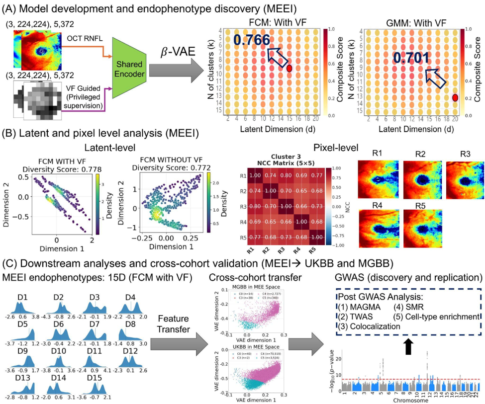
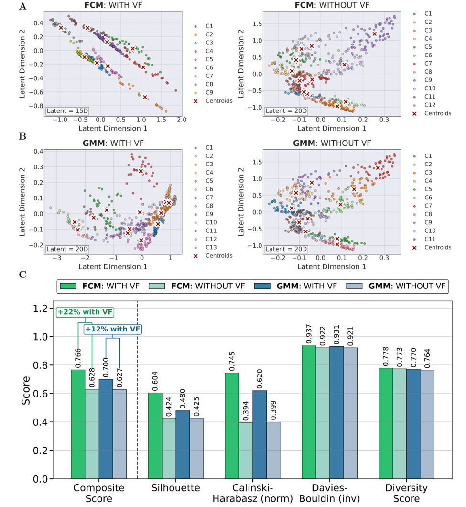
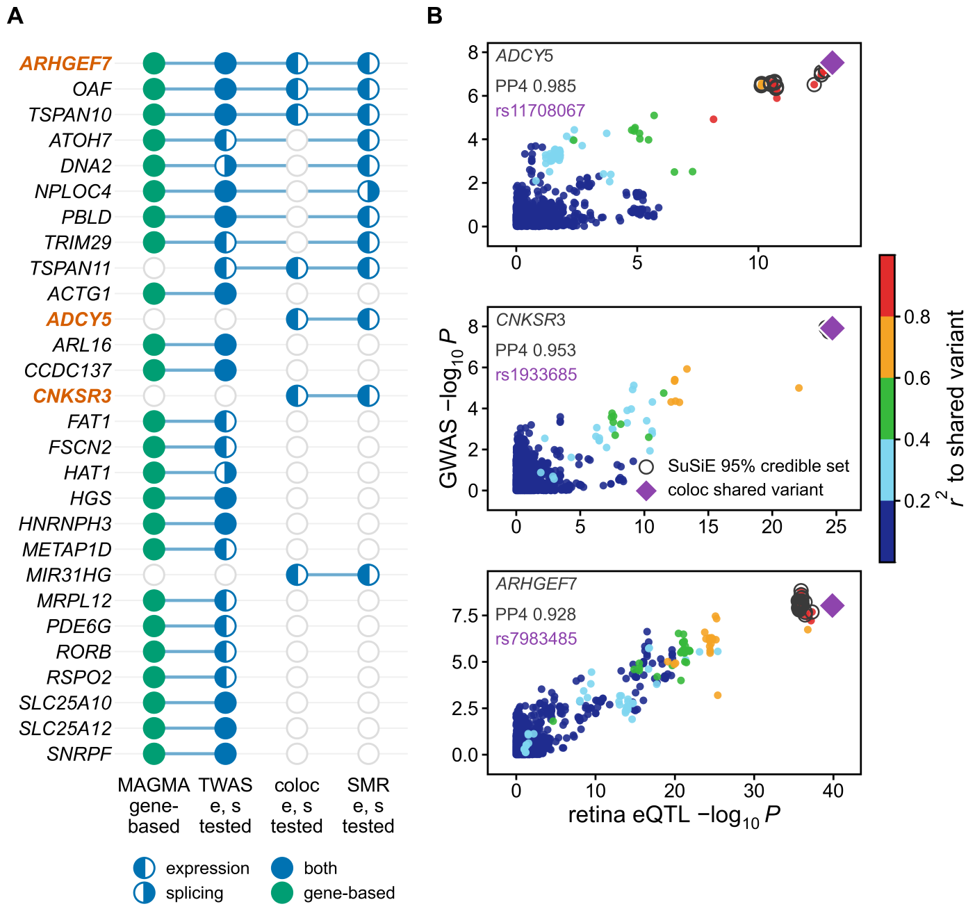

# FORGE: Functionally guided OCT Representation for Glaucoma Endophenotyping

**Mousa Moradi\*, Liyin Chen\*, Yan Zhao, Sayuri Sekimitsu, Niloufar Bineshfar, Janey L. Wiggs, Mohammad Eslami, Mengyu Wang, Tobias Elze, Ayellet V. Segrè, Nazlee Zebardast\*\***

Harvard Ophthalmology AI Lab, Schepens Eye Research Institute, Massachusetts Eye and Ear, Harvard Medical School · Broad Institute of MIT and Harvard

\*Equal contribution · \*\*Corresponding author: Nazlee_Zebardast@MEEI.HARVARD.EDU

---

FORGE is a cross-modal, privileged-learning framework for glaucoma endophenotyping. It uses the **visual field (VF) as privileged supervision during training** to shape an OCT macular RNFL (mRNFL) representation, and a **learned null embedding** makes the VF dispensable at inference, so endophenotypes can be assigned from **structural OCT alone**. This lets a model trained on a small, richly phenotyped clinical dataset (Mass Eye and Ear) be deployed, without refitting, to population-scale imaging biobanks that lack perimetry (UK Biobank, Mass General Brigham Biobank) for genome-wide discovery.



**Fig. 1. FORGE framework.** (A) Paired OCT RNFL and VF images are encoded by a shared encoder trained with privileged VF supervision; a β-VAE sweep over latent dimension and cluster number (FCM and GMM) selects the configuration by composite clustering score (FCM, d = 15, k = 9, 0.766; GMM, d = 20, k = 13, 0.701). (B) Latent- and pixel-level analysis: diversity-scored latent embeddings (with vs. without VF) and per-cluster normalized cross-correlation (NCC) matrices with representative RNFL maps. (C) Learned endophenotypes transfer cross-cohort to UK Biobank and MGB Biobank for GWAS discovery and replication, followed by post-GWAS analyses; OCT-only inference is enabled by replacing the VF input with the learned null embedding.

## Key results

| | |
|---|---|
| Development cohort | 5,372 paired OCT–VF examinations, 1,845 patients, 2,819 eyes (Mass Eye and Ear) |
| Endophenotypes | 15 continuous mRNFL latent axes (FCM, 15D) → 9 phenotypic clusters; GMM (20D) → 13 clusters as a robustness check |
| Effect of VF guidance | Composite clustering score **+22.0 %** for FCM (0.766 vs 0.628) and **+11.3 %** for GMM (0.701 vs 0.630) over an identically trained OCT-only ablation |
| External transfer (no refitting) | 74,077 UK Biobank images (47,252 participants) and 3,119 MGB Biobank images (1,020 participants); per-cluster mean RNFL thickness concordant across cohorts (Lin's CCC 0.74) |
| Clinical validity (UKBB) | 14/15 axes associated with POAG (max OR 2.17 per SD); 15 endophenotypes add +0.023 AUROC over age, sex, IOP, RNFL thickness and a POAG polygenic score |
| GWAS (39,381 UKBB Europeans) | **53 LD-independent loci** in 41 regions, **23 novel** for glaucoma/IOP; all 15 axes heritable (LDSC h² 0.06–0.12) |
| Replication (711 MGBB Europeans) | 75 % sign concordance (P = 0.002), Deming slope 0.74 |
| VF guidance vs ablation | Median heritability Z 6.15 vs 4.76 (P = 9 × 10⁻⁵); only VF-guided axes resolve retinal ganglion-cell enrichment |
| Prioritized genes | 27 putative causal genes; *ARHGEF7*, *CNKSR3*, *ADCY5* at novel loci supported by retina colocalization and SMR |

### Visual-field guidance improves the learned representation



**Fig. 2.** (A, B) Latent-space projections and cluster assignments for FCM (9 clusters, 15D) and GMM (13 clusters, 20D), with VF guidance (left) vs. the OCT-only ablation (right). (C) Clustering quality metrics on the held-out MEE test partition (n = 538): composite score, Silhouette, normalized Calinski–Harabasz, inverted Davies–Bouldin and diversity score. The gain is consistent across every metric and both clustering algorithms.

### Four lines of genetic evidence prioritize 27 genes



**Fig. 7.** (A) Support from MAGMA gene-based association, S-PrediXcan/S-MultiXcan transcriptome- and splicing-wide association, colocalization and SMR for the 27 genes supported by at least two analyses. *ARHGEF7*, *CNKSR3* and *ADCY5* (orange) are at loci novel to POAG, IOP and our previous OCT-only endophenotype GWAS. (B) Locus-comparison plots at those three loci (retina cis-eQTL vs. GWAS −log₁₀ P), with SuSiE 95 % credible-set members and the coloc shared variant.

## Repository layout

```
FORGE/
├── README.md
├── LICENSE                       MIT
├── requirements.txt              minimum library versions
├── training/
│   └── train_forge.py            stage 1 — VF-guided (privileged) contrastive encoder, patient-level 5-fold CV
├── phenotyping/
│   ├── forge_phenotyping.py      shared toolkit: beta-VAE, FCM, GMM, diversity metrics, composite score, NCC, figures, artifact I/O
│   ├── run_vae_fcm.py            stage 2 — beta-VAE + fuzzy c-means sweep and final fit (primary endophenotypes)
│   └── run_vae_gmm.py            stage 2 — beta-VAE + Gaussian-mixture sweep and final fit (robustness check)
├── inference/
│   └── transfer_inference.py     stage 3 — frozen MEE encoder / scaler / VAE / cluster model applied to UKBB or MGBB
├── validation_and_genetics/      stage 4 — phenotypic validation, GWAS, heritability, replication, post-GWAS
│   ├── common.py                 shared helpers (trait names, summary-statistic reader, BH-FDR, M_eff = 5)
│   ├── phenotypic_validation/    criterion / convergent / discriminant associations; incremental AUROC
│   ├── gwas/                     UKBB sample QC, ancestry, REGENIE, call-rate filter, clumping, locus definition
│   ├── heritability/             LDSC, GCTA-GREML, genetic vs phenotypic correlation, M_eff, VF-guided vs no-VF
│   ├── novelty/                  LEAD / PROXY / PROXIMITY classification of leads against published loci
│   ├── mgbb/                     MGBB phenotypes, PLINK 2 --glm, locus-clustered replication, POAG association
│   └── post-gwas/
│       ├── finemap/              SuSiE-RSS with UK Biobank LD windows
│       ├── gene/                 MAGMA, S-PrediXcan / S-MultiXcan (GTEx v8 MASHR)
│       ├── coloc/                coloc vs GTEx (eQTL Catalogue SuSiE) and EyeGEx retina; locus-compare check
│       └── smr/                  SMR / HEIDI with GTEx and retina BESD files
├── environment_gwas.yml          conda environment for validation_and_genetics/
└── figures/
    ├── fig1_forge_framework.png
    ├── fig2_vf_guidance_ablation.png
    └── fig7_gene_prioritization.png
```

The three stages chain through files on disk (no cohort-specific paths are hard-coded; everything is set by environment variables or the `Config` class at the top of each script):

```
train_forge.py ──► outputs/embeddings/entangled_rnfl_embeddings_both_oof.npy          (VF-guided path)
               ──► outputs/embeddings/entangled_rnfl_octonly_embeddings_both_oof.npy  (null-VF / OCT-only path)
               ──► outputs/embeddings/oof_metadata_both.csv
               ──► outputs/models/best_entangled_vf_rnfl_model_both_fold{k}.pt
run_vae_fcm.py ──► outputs/phenotyping/fcm/{scaler,vae,fcm_model,spec}_*_{with_vf,without_vf}.*
transfer_inference.py (UKBB / MGBB images + the artifacts above) ──► outputs/inference_<cohort>/*_participant_level.csv  (GWAS phenotypes)
validation_and_genetics/ (participant-level axes + genotypes) ──► $OUT/{loci,finemap,magma,twas,coloc,smr,mgbb,...}
```

## Installation

```bash
git clone git@github.com:Mousamoradi/FORGE.git
cd FORGE
python -m venv .venv && source .venv/bin/activate      # Windows: .venv\Scripts\activate
pip install -r requirements.txt
```

Requires Python ≥ 3.9 and a CUDA-capable GPU for training (the paper used NVIDIA H100 80 GB; ≈2–3 min per epoch on the 5,372-scan MEE dataset). CPU execution works for inference but is slow for training.

## Data preparation

Clinical data from Mass Eye and Ear cannot be redistributed (IRB); UK Biobank and MGB Biobank data are available through their respective access procedures. To train on your own paired data, use the following layout:

```
<data_root>/
├── rnfl/                      artifact-corrected mRNFL thickness maps (RGB .jpg)
│   ├── 10023_OD_20190412_1.jpg
│   └── ...
├── vf/                        matched visual-field images (RGB .jpg)
│   ├── 10023_OD_20190412_1.jpg
│   └── ...
└── progression_labels.csv     columns: ID, Eye, Date, index, Progression_Ensemble
```

* File names follow `ID_EYE_DATE_INDEX.jpg` with `EYE ∈ {OD, OS}`. RNFL and VF images are paired by exact match on all four fields (OCT–VF temporal matching within ±6 months is done upstream).
* `Progression_Ensemble` is the binary VF-progression label (0 = not worsening, 1 = worsening) from the `vfprogression` ensemble criteria (MD slope, Schell method, VFI). Images without a label are still used for the self-supervised objectives (`ignore_index = -1`).
* Inputs expected by the script are the **artifact-corrected** maps: OCT scans (Zeiss CIRRUS HD-OCT, 200 × 200 macular cube, 6 × 6 mm) with signal strength ≥ 7 and ≤ 5 % missing pixels, inpainted with the partial-convolution U-Net described in the paper (Methods, *Artifact Correction*).

## Training

```bash
FORGE_DATA_ROOT=/path/to/data \
FORGE_OUTPUT_DIR=./outputs/embeddings \
FORGE_MODEL_DIR=./outputs/models \
python training/train_forge.py
```

All hyperparameters live in the `Config` class at the top of `train_forge.py`:

| Group | Setting |
|---|---|
| Backbone | ImageNet-pretrained ResNet-50, shared by both modalities → 512-D shared bottleneck |
| Modality encoders | 256-D RNFL and VF encoders with residual projection |
| Entangled fusion | 8-head cross-attention (RNFL ↔ VF) + FiLM modulation (`z'_RNFL = γ(z_VF) ⊙ z_RNFL + β(z_VF)`) → 256-D joint embedding |
| Privileged VF | learned `null_vf_embedding` (256-D); VF dropout p = 0.1 during training |
| Contrastive | MoCo queue K = 4096, momentum m = 0.999, temperature τ = 0.1 |
| Loss (Eq. 6) | L = λ₁·L_MoCo + λ₂·L_cross + λ₃·L_div + λ₄·L_prog with **λ = (0.3, 0.15, 0.15, 0.4)**, selected with Optuna (20 trials) on validation clustering metrics. L_cross = cross-modal consistency between the joint embedding and each modality (Eq. 3); L_div = anti-collapse margin on RNFL–VF cosine similarity (Eq. 4); L_prog = progression cross-entropy on the joint and RNFL heads (Eq. 5). |
| Optimization | AdamW, lr 5 × 10⁻⁵ (2× for fusion/classifier heads), wd 5 × 10⁻⁵, 15-epoch warm-up + cosine, grad-clip 0.5, AMP, batch 16, ≤ 150 epochs, early stopping (patience 9) on validation loss − 0.2 × accuracy |
| Cross-validation | **Patient-level, label-stratified five-fold CV** (`StratifiedGroupKFold`, groups = patient ID, strata = patient's majority progression label). In each fold 80 % of patients are used for training + validation (a further patient-level split gives 70 % train / 10 % val) and 20 % are held out for testing. All examinations and both eyes of a patient belong to exactly one fold; the script asserts this. |

A fresh model is trained in every fold, the best checkpoint of that fold is reloaded, held-out metrics are computed on the test patients, and the held-out scans' embeddings are written. Across the five folds every scan is held out exactly once, giving a complete out-of-fold embedding set for the downstream β-VAE / clustering stage. Set `Config.folds_to_run = [0]` to run a single fold.

**Outputs** (`FORGE_MODEL_DIR` / `FORGE_OUTPUT_DIR`, default `./outputs/`)

* `models/best_entangled_vf_rnfl_model_both_fold{k}.pt` — best checkpoint per fold (model/optimizer state, config, history)
* `embeddings/cv_fold_assignment_both.csv` — fold of every scan (`ID, Eye, Date, Index, class_label, fold`)
* `embeddings/entangled_{joint,rnfl,vf}_embeddings_both_fold{k}.npy` — held-out 256-D embeddings of fold *k*, VF-guided path
* `embeddings/entangled_{joint,rnfl}_octonly_embeddings_both_fold{k}.npy` — same scans through the OCT-only (null-VF) path
* `embeddings/test_metadata_both_fold{k}.csv` — row order of the per-fold `.npy` files
* `embeddings/entangled_*_embeddings_both_oof.npy` + `oof_metadata_both.csv` — all scans, out-of-fold, in the order of `oof_metadata_both.csv` (written when all five folds run)
* `embeddings/cv_summary_both.json` — per-fold best epoch, validation loss/accuracy, held-out accuracy and AUROC, and their mean ± SD

### OCT-only inference (learned null embedding)

The trained model runs on RNFL alone by passing `vf_img=None`; the learned null embedding is substituted for the missing modality:

```python
import torch
from training.train_forge import EntangledVFRNFLModel, config, get_medical_transforms

ckpt = torch.load("outputs/models/best_entangled_vf_rnfl_model_both_fold0.pt",
                  map_location="cuda", weights_only=False)
model = EntangledVFRNFLModel(config, num_classes=2).cuda().eval()
model.load_state_dict(ckpt["model_state_dict"])

x = get_medical_transforms(training=False)(rnfl_pil_image).unsqueeze(0).cuda()
eye = torch.tensor([0]).cuda()                       # 0 = OD, 1 = OS
with torch.no_grad():
    out = model(x, vf_img=None, eye_labels=eye, inference_mode=True)
rnfl_embedding = out["rnfl_embedding"]               # 256-D, used for all external cohorts
```

This is the path used to phenotype UK Biobank and MGB Biobank, neither of which has paired perimetry.

## Stage 2 — endophenotype discovery (β-VAE + FCM / GMM)

```bash
FORGE_DATA_ROOT=/path/to/data FORGE_OUTPUT_DIR=./outputs/embeddings python phenotyping/run_vae_fcm.py
FORGE_DATA_ROOT=/path/to/data FORGE_OUTPUT_DIR=./outputs/embeddings python phenotyping/run_vae_gmm.py
```

Both runners take the two out-of-fold embedding sets from stage 1 — **WITH VF** (VF-guided path) and **WITHOUT VF** (the identically trained model with the VF input replaced by the learned null embedding) — and for each condition:

1. **Sweep** latent dimension *d* ∈ {2, 5, 10, 15, 20} (one β-VAE per *d*: hidden 256-128-64-32, β = 1.25, Adam 10⁻³, early stopping) × cluster number *k* = 4…15 × fuzziness *m* ∈ {1.5, 2.0, 2.5, 3.0} (FCM) or covariance ∈ {full, diag} (GMM). Posterior means μ are the latents.
2. **Score** every configuration with the manuscript composite, `composite = mean(Silhouette, Calinski-Harabasz normalised to [0,1], inverted Davies-Bouldin, diversity score)`; the diversity score summarises per-dimension histogram peaks, peak separation, entropy and multimodality, and mean KL(N(μ,σ²)‖N(0,1)), entropy and peak-location diversity are reported alongside (Table 2). `fig_composite_grid_*.png` is the *d* × *k* grid of Fig. 1A.
3. **Final fit** at the configuration pinned in `Config.final_spec` (FCM: 15D / 9 clusters / m = 1.5 with VF, 20D / 12 without; GMM: 20D / 13 with VF, 20D / 11 without; set to `None` to use the grid optimum) and save the transfer artifacts: `scaler_*.pkl`, `vae_*.pt`, `fcm_model_*.pkl` / `gmm_model_*.pkl`, `spec_*.json`, latents, per-scan cluster assignments and memberships.
4. **NCC**: for each cluster the 20 highest-membership scans are loaded, their pairwise normalised cross-correlation computed, candidates with mean NCC < 0.08 dropped, and the five best by 0.5·membership + 0.5·mean-NCC shown next to the NCC matrix (`fig_ncc_*.png`, Fig. 1B). Scans whose maximum membership is below 0.7 are moved to their next-best cluster before this step (`membership_threshold`; `None` disables).
5. `table2_<method>.csv` and `fig_metrics_<method>.png` compare the two conditions (Fig. 2C); `fig_latent_scatter_<method>.png` is Fig. 2A/B.

## Stage 3 — cross-cohort transfer (UK Biobank, MGB Biobank)

```bash
FORGE_COHORT=ukbb FORGE_EXTERNAL_IMAGES=/path/to/ukbb/rnfl_inpainted \
FORGE_MODEL_DIR=./outputs/models FORGE_PHENOTYPING_DIR=./outputs/phenotyping \
python inference/transfer_inference.py
```

Pure feature transfer, with nothing refitted on external data: the frozen fold-0 encoder embeds every artifact-corrected map through the **OCT-only (null-VF) path**; the MEE scaler is applied as a transform only; the frozen MEE β-VAE gives posterior-mean latents in the MEE space; memberships are computed against the saved MEE FCM centroids (m = 1.5) or GMM components. By default the `with_vf` FCM artifacts (the 15 VF-guided endophenotypes) are transferred; `Config.method` / `Config.condition` switch to GMM or the ablation.

External file names must start with `<participant>_<eye>` (eye ∈ OD/OS/R/L/RIGHT/LEFT); a `YYYYMMDD` or `YYYY-MM-DD` token, if present, is used as the acquisition date. Outputs per cohort: 256-D embeddings, latents, memberships, a scan-level CSV, NCC panels, and **`<cohort>_<method>_<condition>_participant_level.csv`** — one row per participant built exactly as in Methods (most recent scan per eye, both eyes averaged on the participant's most recent date; all scans averaged when no date is available), which is the quantitative-trait file for the GWAS.

## Stage 4 — phenotypic validation and genetics (`validation_and_genetics/`)

The 15 FCM axes from stage 3 (`*_participant_level.csv`, one row per participant) are the quantitative traits. Scripts are small, single-purpose and run in the order below; each has a usage line in its docstring. They read every cohort- or machine-specific path from **environment variables** (never hard-coded), write under `$OUT`, and the trait columns are `fcm_z1..fcm_z15` (VF-guided) and `wovf_z1..wovf_z20` (no-VF ablation). Install the environment first:

```bash
conda env create -f environment_gwas.yml && conda activate forge-gwas
export FORGE=/path/to/FORGE/validation_and_genetics OUT=/path/to/results SUMSTATS=/path/to/regenie/sumstats
```

| Step | Scripts | Manuscript correspondence |
|---|---|---|
| Sample QC & ancestry | `gwas/sample_qc.sh`, `gwas/ancestry.py` | withdrawals, sex, heterozygosity, relatedness (π̂ > 0.1875); 1000G PC projection + k-NN → 44,477 Europeans; N = 39,381 with refractive error |
| GWAS | `gwas/regenie.sh fcm\|wovf`, `gwas/callrate_filter.py` | REGENIE v4.1.2 two-step ridge, `--qt --apply-rint`; covariates age, sex, array, spherical equivalent, 10 PCs; ≥ 90 % call rate → 9,050,596 variants |
| Loci | `gwas/clump.sh`, `gwas/define_loci.py`, `gwas/regions.py` | per-trait clumping (r² < 0.1, ±500 kb, P < 5×10⁻⁸), pooled re-clumping → 53 loci / 41 regions; GENCODE v47 nearest gene; region table for fine-mapping, coloc and SMR |
| Phenotypic validity | `phenotypic_validation/associations.py`, `incremental_auc.py` | 16 outcomes in three families (rank-inverse-normal exposures, LRT, BH-FDR); four cumulative ridge-logistic models, nested 5-fold CV × 5 seeds, DeLong tests, permuted-endophenotype control |
| Heritability | `heritability/ldsc.sh`, `greml.sh`, `rg_rp.py`, `meff.py`, `novf_compare.py` | LDSC (HapMap 3) and GCTA-GREML h²; genetic vs phenotypic correlation over the 105 pairs; Li-Ji M_eff = 5; VF-guided vs no-VF h² Z (Mann-Whitney) |
| Novelty | `novelty/proxies.py`, `novelty/classify.py` | LD proxies (r² ≥ 0.2 / 0.8; UKBB and MGBB panels); LEAD > PROXY > PROXIMITY > novel against POAG / IOP / GWAS Catalog / prior OCT-only GWAS → 23 novel loci |
| MGBB replication | `mgbb/pheno_covar.py`, `glm.sh`, `lambda_gc.py`, `replication.py`, `clinical.py` | KING unrelated Europeans (n = 711), PLINK 2 `--glm` on RINT axes; sign concordance (locus-block permutation), r and Deming slope (locus-block bootstrap), per-pair power; POAG logistic regression (n = 435) |
| Fine-mapping | `post-gwas/finemap/get_ukb_ld.sh`, `alkes_windows.py`, `build_ld.py`, `extract_regions.py`, `finemap.py` + `susie_rss.R`, `summarise.py` | SuSiE-RSS (L = 10, 95 % coverage) with UK Biobank 3 Mb LD windows; 47 credible sets in 40 regions |
| Gene-based / TWAS | `post-gwas/gene/gene_ref.py`, `magma.sh`, `magma_summary.py`, `twas_prep.py`, `twas_run.sh`, `twas_summary.py`, `tissues.txt` | MAGMA v1.10 (35 kb / 10 kb window, 1000G EUR); S-PrediXcan × 18 tissues × {expression, splicing} → S-MultiXcan; thresholds 0.05/(features × 15) and 0.05/(features × M_eff) |
| Colocalization | `post-gwas/coloc/fetch_qtl.py`, `coloc_gtex.R`, `retina_extract.sh`, `coloc_retina.R`, `coloc_summary.py`, `locuscompare.py` | coloc v5.2.3: SuSiE-based (`coloc.bf_bf`) against eQTL Catalogue GTEx v8, `coloc.abf` against EyeGEx retina; call rule PP4 ≥ 0.8, PP4/(PP3+PP4) ≥ 0.9, ≥ 500 shared variants; locus-compare confirmation |
| SMR | `post-gwas/smr/windows.py`, `ld_reference.sh`, `fetch_eqtlcat.sh`, `gtex_besd.py`, `retina_besd.py`, `make_ma.py`, `run_smr.sh`, `smr_summary.py` | SMR v1.03 + HEIDI (P > 0.05) with retina (225 tests), GTEx expression and GTEx splicing families |

A putative causal gene is one supported by at least two of MAGMA, S-MultiXcan, colocalization and SMR; this yields the **27 genes** of Fig. 7, three of which (*ARHGEF7*, *CNKSR3*, *ADCY5*) sit at novel loci. ECLIPSER cell-type enrichment (Fig. 8) was run with the Segrè-lab Snakemake implementation and is not duplicated here.

**External tools and references** (installed separately, paths given by environment variables): REGENIE v4.1.2, PLINK 1.9 / 2.0, LDSC, GCTA v1.94.1, MAGMA v1.10, MetaXcan v0.7.5 (a small numpy-2 compatibility patch is included in `post-gwas/gene/`), SMR v1.03, R 4.4 with susieR 0.14.2 and coloc 5.2.3; GENCODE v44/v47, HapMap 3 SNP list, 1000 Genomes Phase 3, UK Biobank LD windows (Weissbrod et al.), GTEx v8 MASHR models, eQTL Catalogue QTS000015, EyeGEx retina eQTL, and the published POAG / IOP association lists used as the novelty reference. UK Biobank and MGB Biobank individual-level data are available only through their access procedures.

## Citation

If you use FORGE, please cite:

```bibtex
@article{moradi2026forge,
  title   = {FORGE: Functionally guided OCT Representation for Glaucoma Endophenotyping},
  author  = {Moradi, Mousa and Chen, Liyin and Zhao, Yan and Sekimitsu, Sayuri and Bineshfar, Niloufar and
             Wiggs, Janey L. and Eslami, Mohammad and Wang, Mengyu and Elze, Tobias and Segr{\`e}, Ayellet V. and
             Zebardast, Nazlee},
  year    = {2026},
  Preprint    = {https://www.medrxiv.org/content/10.64898/2026.05.08.26352729v3}
}
```

## Data and code availability

* Code: this repository (https://github.com/Mousamoradi/FORGE).
* Data supporting the findings can be obtained from the corresponding author upon reasonable request. UK Biobank GWAS summary statistics for the 15 endophenotypes will be shared publicly upon publication.

## Acknowledgments

This research was funded by the National Institutes of Health (R01 EY036518, R01 EY030575, R01 EY038687, R01 EY036222, and P30 EY003790) and Research to Prevent Blindness. This research was conducted using the UK Biobank Resource and the Mass General Brigham Biobank.

## License

Released under the [MIT License](LICENSE).
